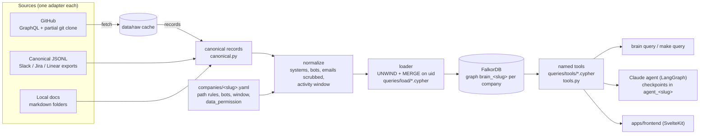

# Company Brain

Every engineering team keeps asking the same three questions: *who knows this system?*, *why
was this decided, and where?*, and *what breaks if we change it?* The answers already exist,
scattered across commits, pull requests, reviews, issues, CODEOWNERS and docs. Company Brain
turns a company's public engineering activity into **one FalkorDB graph** (people, teams, code
areas, changes, work items, documents) and answers those questions with **deterministic,
named graph queries**. Every answer comes with its sources (URLs) and the graph path behind it.
Any company can be added with a config file. The first one is FalkorDB itself.

Entry for *Graph Hacks: Context for AI Agents* (FalkorDB × WeMakeDevs, Oct 15–18 2026).
Tracks: **Company Brain** and **Agent Memory & Coordination**.

## Architecture



- **FalkorDB is the only store.** Each company is an isolated graph, `brain_<slug>`. Raw API
  responses are cached on disk as ingestion input; nothing reads them at runtime.
- **No LLM-generated Cypher.** Every query the product runs is a `.cypher` file with a header
  (purpose, params, returns, example). Python loads them by name.
- **Expertise is derived, not stored**: Person → Change → System, weighted by recency, computed
  at query time, so it is current as soon as new commits land.
- **Company-agnostic.** A new company is a YAML file. A new kind of source is one adapter
  module plus one registry line, with no change to the loader, schema or queries.
- **Only public, synthetic or own data.** Each config declares `data_permission`. Private
  GitHub repos are refused unless it is `own`. No email addresses are stored anywhere.

## Quick start

Needs Docker, [uv](https://docs.astral.sh/uv/), and a GitHub token (`GITHUB_TOKEN` in `.env`
or a logged-in `gh` CLI) for GitHub sources.

```bash
make setup                      # uv sync + .env from .env.example
make up                         # FalkorDB on :6379, Browser UI on http://localhost:3000
make schema                     # indexes on brain_falkordb (SLUG defaults to falkordb)
make sync                       # fetch FalkorDB/FalkorDB since 2026-04-15 (~3 min first time) + ingest
make query TOOL=experts_for_system P="system=CI"
```

No token? The offline demo company works with no network at all:

```bash
make synthetic                  # brain_synthetic: 6 people, 2 teams, 4 systems, 15 work items
make query SLUG=synthetic TOOL=owners_vs_experts
make query SLUG=synthetic TOOL=path_between P="from_uid=person:erin to_uid=system:Auth"
```

`make tools` lists every tool and its parameters; `JSON=1` prints raw rows. The CLI underneath
is `uv run brain query <slug> <tool> key=value ...` (or `--param key=value`). The Claude agent
that answers questions over these tools (`brain ask`) is on branch `feat/claude-agent`.

What `brain_falkordb` held after the first sync (window from 2026-04-15): 750 PRs, 994 issues,
259 commits, 190 people, 71 systems, 16 docs, 2,733 comment chunks.

## The graph

Full model, with the Mermaid diagram: **[docs/graph-model.md](docs/graph-model.md)**.

Nodes: `Person`, `Team`, `System`, `Change`, `WorkItem` (PRs, issues, tickets, threads),
`Document`, `Chunk`, `Decision` and `Episode` (defined, written by the agents later), `SyncState`.
Relationships: `AUTHORED`, `REVIEWED`, `COMMENTED_ON`, `MEMBER_OF`, `OWNS`, `TOUCHES`,
`PART_OF`, `CLOSES`, `MENTIONS`, `FROM`.

## Every Cypher query

All under [`apps/backend/queries/`](apps/backend/queries/). Each file starts with a header:
purpose, parameters, returns, example.

### Tools (read side: CLI, agents, UI)

| File | Purpose |
|---|---|
| `tools/experts_for_system.cypher` | Who knows a system: people ranked by recency-weighted commits and reviews in it, bots excluded, declared owners alongside |
| `tools/owners_vs_experts.cypher` | Systems whose declared owners (CODEOWNERS) are not the top contributors |
| `tools/work_history.cypher` | Recent PRs/issues that changed or mention a system, with authors, reviewers and closed issues |
| `tools/impact_of.cypher` | Systems changed in the same commits as a system (co-change coupling), with their people and owners |
| `tools/path_between.cypher` | Shortest relationship paths between two nodes, either direction (`algo.SPpaths`) |
| `tools/related_work_items.cypher` | Full-text search over PRs/issues/threads, expanded to authors, systems and closing links |
| `tools/related_documents.cypher` | Full-text search over docs/ADRs, with the systems and work items they mention |
| `tools/person_profile.cypher` | One person's teams, systems, recent PRs, reviews and declared ownership |
| `tools/get_entity.cypher` | Open any node by uid: fields, text and direct neighbours |
| `tools/list_systems.cypher` | All systems with change counts, people and owners |
| `tools/graph_stats.cypher` | Node and relationship counts per type |

### Schema (`make schema`)

| File | Purpose |
|---|---|
| `schema/range_indexes.cypher` | Range indexes on every label's `uid`, plus `Person.login`, `WorkItem.number`, `System.name` |
| `schema/fulltext_indexes.cypher` | Full-text indexes on `WorkItem` and `Document` title and body |
| `schema/vector_index.cypher` | HNSW cosine vector index on `Chunk.embedding` (dimension from `EMBEDDING_DIM`) |
| `schema/list_indexes.cypher` | List indexes; used to warn when the vector dimension does not match |

### Load (write side: `make ingest`)

| File | Purpose |
|---|---|
| `load/person.cypher`, `load/team.cypher`, `load/system.cypher` | Upsert people, teams, systems (MERGE on uid, then SET) |
| `load/work_item.cypher`, `load/document.cypher`, `load/change.cypher` | Upsert PRs/issues/threads, documents, commits |
| `load/authored_change.cypher`, `load/authored_work_item.cypher`, `load/authored_document.cypher` | `(Person)-[:AUTHORED]->(...)`, one file per target label |
| `load/touches.cypher` | `(Change)-[:TOUCHES {files}]->(System)` |
| `load/reviewed.cypher` | `(Person)-[:REVIEWED {state}]->(WorkItem)`, latest review wins |
| `load/comment_chunk.cypher` | Comment text as a `Chunk` FROM its work item |
| `load/commented_on.cypher` | `(Person)-[:COMMENTED_ON {count, last_at}]->(WorkItem)`, count recomputed from chunks |
| `load/owns_team.cypher`, `load/owns_person.cypher` | Declared ownership `OWNS {pattern}` |
| `load/link_closes.cypher` | `(WorkItem)-[:CLOSES]->(WorkItem)` |
| `load/link_part_of.cypher` | `(Change)-[:PART_OF]->(WorkItem)` |
| `load/link_member_of.cypher` | `(Person)-[:MEMBER_OF]->(Team)` |
| `load/link_mentions_workitem_workitem.cypher`, `load/link_mentions_workitem_system.cypher`, `load/link_mentions_document_workitem.cypher`, `load/link_mentions_document_system.cypher` | `MENTIONS`, one file per allowed label pair |
| `load/sync_state_set.cypher`, `load/sync_state_get.cypher` | Incremental-ingest cursor per configured source |

Relationship types and labels cannot be Cypher parameters, which is why each allowed
combination has its own small file rather than one query built from strings.

## Adding a company

**[docs/adding-a-company.md](docs/adding-a-company.md)**: (a) a public GitHub repo (copy the
config, edit the path rules, sync), (b) Slack/Jira/Linear exports via
[canonical JSONL](docs/canonical-format.md) or a new adapter (skeleton in
`apps/backend/brain/adapters/_template.py`), (c) a synthetic demo company.

## Repository

```
apps/backend/     Python 3.12 (uv): ingestion, schema, named queries, agents. CLI: brain
  brain/            cli, config, canonical, normalize, loader, pipeline, tools, db, adapters/
  queries/          schema/, load/, tools/  (every Cypher query)
  examples/         synthetic_company/ (offline demo data + generator)
  tests/            pytest; graph tests use a real FalkorDB (make up) and throwaway graphs
apps/frontend/    SvelteKit UI and design system (make fe-install, make fe-dev)
companies/        one YAML per company -> graph brain_<slug>
docs/             graph model, canonical format, adding a company
data/             gitignored: raw API caches and inbox folders
```

`make test` runs the suite (graph tests are skipped when FalkorDB is not running), `make lint`
runs ruff. The same code runs against FalkorDB Cloud: set `FALKORDB_HOST/PORT/USERNAME/PASSWORD`
(and `FALKORDB_TLS=true` when the instance uses TLS) in `.env`.

## AI usage

An AI coding assistant was used to build this project; what it did is listed in
[AI_USAGE.md](AI_USAGE.md).
