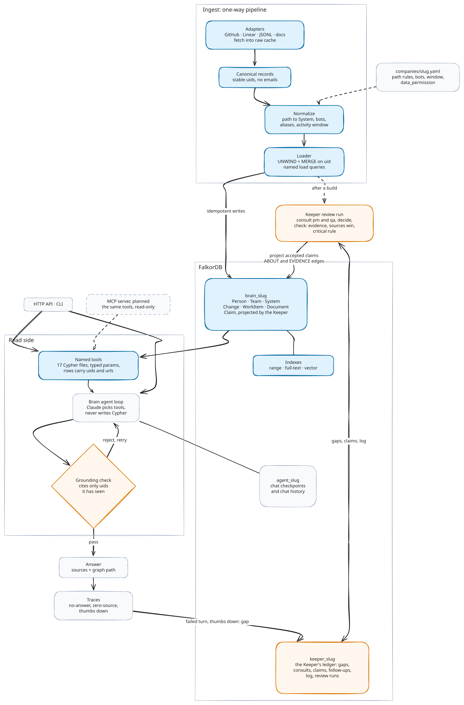
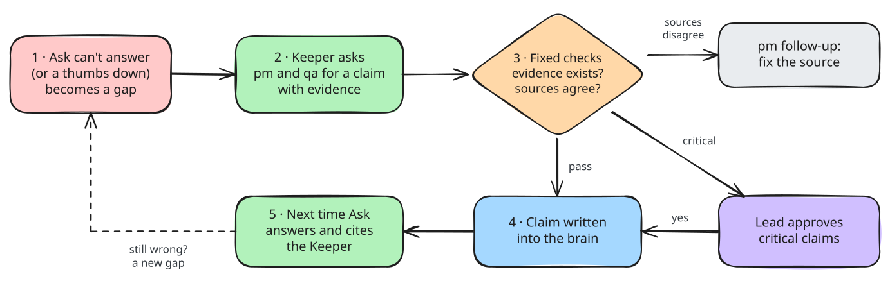

# Citadel: Company Brain and its Keeper

**A living memory of how your company builds software that agents can query, and the Keeper: the
agent that repairs it.**

Citadel is our entry for *Graph Hacks: Context for AI Agents* (FalkorDB × WeMakeDevs, Oct 15–18 2026).
Tracks: **Company Brain** and **Agent Memory & Coordination** ([how Citadel covers Track 02](#agent-memory--coordination-track-02)).

## The problem

Every team keeps asking the same questions: *who knows this system? why was this decided? what
breaks if we change it?* The answers already exist, scattered across commits, pull requests,
reviews, tickets and docs. Nobody can hold all of it in their head, and AI assistants without
that context guess.

Company Brain puts it all in **one graph per company** and answers from it, with the sources and
the graph path behind every answer. When the graph does not know something, it does not guess:
the **Keeper** finds out, checks the answer against the sources, and writes it back. Each question
the brain cannot answer makes it better for the next person.

**Sources win.** The Keeper only fills in what the sources don't say. When one of its owner or
expert claims disagrees with the declared owners (CODEOWNERS) or with who does most of the work,
the source is kept, the claim is set aside, and the `pm` agent opens a follow-up to fix the
source.

## Meet the Keeper

Most knowledge bases rot: an answer is wrong, someone shrugs, and the next person gets the same
wrong answer. The Keeper is the agent that stops this. It watches every question the brain gets:

- **It notices what the brain could not answer.** A question with no answer or no source, a
  thumbs-down, or an owner who no longer does the work becomes a gap in its ledger.
- **It asks other agents, then checks them.** `pm` and `qa` answer with draft claims that cite
  real nodes. Fixed rules in code, not the model, decide what gets in: the evidence must exist,
  the sources win, and a critical claim waits for a lead to approve it.
- **It writes back, and shows its work.** An accepted claim becomes a dated `Claim` node linked to
  its evidence. The next answer cites it and says it comes from the Keeper. Every step is in the
  log: who, what, why, and who approved it.

In the app, the Systems page shows each Keeper review step by step on the agent trail, with
**Review now**, the claims waiting for a lead, and the log in its rail. A review also runs offline
with scripted agents, so the demo company needs no API key.

How a gap becomes a claim: [The self-healing loop](#the-self-healing-loop).

## What we are building

| Part | What it does | Status |
|---|---|---|
| **The Brain** | One FalkorDB graph per company (`brain_<slug>`), built from GitHub, Linear, docs and chat exports: people, teams, systems, changes, work items, documents | Built |
| **Named graph tools** | 22 read queries, each a reviewed `.cypher` file with typed params. Agents pick a tool and fill its params; no LLM ever writes Cypher | Built |
| **Ask** (`brain` agent) | A Claude agent that answers from the tools and may cite only the nodes it has seen. Every turn is traced (no-answer, zero-source, thumbs). It answers from the sources first and says when a part comes from the Keeper | Built |
| **Keeper** (`keeper` agent) | Turns failed questions, thumbs-down answers and what it notices after a build into gaps, consults `pm` and `qa`, checks their claims against the sources and a fixed critical rule, asks a lead to approve the critical ones, writes the rest into the brain, and logs every step | Built: HTTP API and app |
| **`pm` and `qa` agents** | Answer the Keeper's consults with draft claims that cite real nodes; `pm` opens a follow-up for each new owner, expert or decision claim, and for each claim the sources contradict. They never message each other: the Keeper's ledger graph is the only channel ([spec](docs/agents.md)) | Built |
| **Archivist** (`archivist` agent) | Goes back past the ingest window when Ask meets a reference to an old item (or the Keeper has a gap about old history): finds it on GitHub or Linear, checks it against the brain, loads it, and hands back what it found. Fixed budgets and grounding checks, kept across rebuilds ([spec](docs/agents.md#the-archivist)) | Built |
| **Keeper in the app** | Keeper reviews as steps on the Systems page's agent trail, with Review now, the approvals card and the log in its rail | Built |
| **MCP server** | The same named tools for any outside agent (Claude, an IDE, a Slack bot), read-only, plus one gated `propose_claim` write | Planned |

## How it works



Five agents: `brain` answers questions, `keeper` keeps the brain right, `pm` and `qa` advise it, `archivist` fetches older history.

- **People ask, the brain answers.** A CEO or tech lead asks in the app (an outside AI agent will
  ask over MCP, planned). Both go through the same named tools and get an answer with sources and
  a graph path.
- **The Keeper takes over when the brain cannot answer.** A turn with no answer or no source, or
  an answer that gets a thumbs down, becomes a gap in the Keeper's ledger. After each build the
  Keeper also notices gaps on its own (stale owners, busy systems nobody owns).
- **Agents talk through the ledger.** The Keeper posts a consult for `pm` and one for `qa`; each
  finds it in its own queue and answers with a draft claim that cites real nodes. No agent calls
  another, so every exchange is stored and can be audited.
- **Only checked knowledge reaches the brain.** Fixed rules in code, not the model, decide: the
  evidence must exist, the sources win, and a critical claim waits for a lead's approval. An
  accepted claim is written into the brain as its own dated `Claim` node, linked to its evidence.

## Inside the brain



- **Ingest is a one-way pipeline.** Adapters fetch into a raw cache, records become canonical
  (stable uids, no emails), company rules from `companies/<slug>.yaml` are applied, and the loader
  `MERGE`s everything on uid. Loads are idempotent, and a re-ingest makes no API calls.
- **FalkorDB is the only store.** Each company is an isolated graph `brain_<slug>`, with range,
  full-text and vector indexes. Chat state and history live in `agent_<slug>`. The Keeper's
  ledger lives in `keeper_<slug>`, so it survives a rebuild; accepted claims are projected back
  into `brain_<slug>` after every accept and every build.
- **The read side is deterministic.** Claude chooses which named tool to call. The query is always
  one we wrote and reviewed. A grounding check rejects any answer that cites a node the agent did
  not see.
- **Expertise is derived, not stored.** It is computed from Person → Change → System, weighted by
  recency, at query time, so it is current the moment new commits land.

## The self-healing loop



Built in `apps/agents/agents/keeper/` (spec: ["The Keeper" in docs/agents.md](docs/agents.md#the-keeper)):

1. **Gaps.** A failed Ask turn (no answer, or no source) and a thumbs-down each open a gap in
   `keeper_<slug>`, written after the answer or rating is sent, so it never slows or fails it. The
   same question again bumps the gap's count. After each build, noticing queries open gaps for
   `stale_owner` (the declared owners are not the person doing most of the work) and
   `unowned_hot_system` (a busy system with no declared owner), at most 10 new ones per run.
2. **Review run.** One per company at a time: 5 gaps on Review now, 3 after a build. Asked gaps
   come first, then the most seen. Each gap gets a consult for `pm` and for `qa`; then the Keeper
   decides: a claim, `needs_person` (nobody could ground it) or `dismiss` (noise).
3. **Fixed checks.** Every evidence uid must exist in the brain, or the claim is rejected (after 2
   rejections the gap needs a person). A claim the sources contradict becomes
   `conflicts_with_source`: never written into the brain, and `pm` opens a follow-up to fix the
   source. A claim is critical when it replaces an earlier claim, touches a high-impact system (top
   quarter by PageRank over the whole graph) or rests on no commit, work item or document.
4. **Approve or write.** A critical claim waits for a lead (the approvals card on the Systems page, or the
   API). Any other is accepted at once. An accepted claim supersedes the earlier one (`valid_to`
   set) and is projected into the brain. Nothing is deleted.
5. **Ask again.** Ask reads accepted claims through `keeper_notes` and `get_entity`, cites them,
   and says that part comes from the Keeper. After each build every accepted claim is checked
   again: one the sources now contradict is superseded, and one whose evidence is gone goes stale
   and reopens its gap.

Every step is a line in the Keeper's log: who, what, why, the evidence, and who approved it (a
lead's name, or "auto"). Without an API key a review only re-projects claims and notices gaps,
and is recorded as skipped.

The diagrams are Excalidraw scenes: open the `.excalidraw` files in
[docs/architecture/](docs/architecture/) at [excalidraw.com](https://excalidraw.com) (File → Open)
to edit them, then export SVG over the old one. The `.mmd` files are the Mermaid sources the
scenes were first generated from.

## Agent Memory & Coordination (Track 02)

Where each part of the track lives. Each company has three graphs in one FalkorDB: `brain_<slug>`
(what the company knows), `agent_<slug>` (the agents' chats) and `keeper_<slug>` (the Keeper's
ledger, which survives a rebuild of the brain).

| Track 02 asks for | In Citadel | Code | Proof (test) |
|---|---|---|---|
| **Episodic memory** | Every Ask turn as a graph in `agent_<slug>`: `Thread → Turn → LLMCall → ToolCall → Ref`, beside the LangGraph checkpoints that resume a thread. Every Keeper review as `Review` + `ReviewStep`s, and an append-only log (who, what, why, who approved) in `keeper_<slug>`. Plus one trace line per turn in `data/traces/<slug>.jsonl` (tools, stop, tokens, thumbs) | `agents/history.py`, `agents/checkpoint.py`, `agents/keeper/store.py`, `agents/traces.py` | `test_history_graph.py`, `test_keeper_store.py`, `test_traces.py` |
| **Semantic memory** | Accepted claims projected into `brain_<slug>` as `Claim` nodes with `ABOUT` and `EVIDENCE` edges. Ask reads them through `keeper_notes` and `get_entity`, cites them and says they come from the Keeper | `agents/keeper/project.py`, `brain/keeper.py`, `queries/keeper/project_claim.cypher` | `test_keeper_decide.py` |
| **Memory that changes** | A claim has `valid_from` / `valid_to`. A new claim supersedes the old one, nothing is deleted. After every build each accepted claim is checked again: one the sources now contradict is superseded, one whose evidence is gone goes stale and reopens its gap | `agents/keeper/decide.py`, `agents/keeper/review.py` | `test_supersedes_earlier_claim`, `test_stale_on_projection_missing` |
| **Procedural memory** | How the agents act is fixed in reviewed files, not learned or improvised: 22 named Cypher tools with typed params, plus one guarded read-only `run_cypher` for what they miss, the Keeper's fixed rules (evidence must exist, sources win, the critical rule), one prompt per role | `brain/tools.py`, `queries/tools/`, `agents/keeper/rules.py`, `agents/prompts/` | `test_keeper_rules.py` |
| **Shared state and handoffs** | Agents never message each other: the ledger is the only channel. The Keeper posts a `Consult` per gap for `pm` and `qa` (idempotent per gap, role and attempt). Each role reads its own queue and answers once with a draft claim citing real uids. The Keeper reads the answers and decides | `queries/ledger/post_consult.cypher`, `queue_consult.cypher`, `answer_consult.cypher` | `test_keeper_review.py`, `test_keeper_jobs.py` |
| **Concurrency** | Every status move is guarded in its Cypher (`WHERE c.status IN $from`), so of two racing approvals, or an approve and a reject, one wins and the other changes nothing (HTTP 409). One review per company at a time; nothing reviews or decides while the company rebuilds | `queries/ledger/set_claim_status.cypher`, `agents/keeper/decide.py` (`ClaimNotPending`), `backend/keeper_runs.py` | `test_claim_status_guard` (memory store and real FalkorDB), `test_approve_twice` |
| **Isolation** | One graph per company; `brain/db.py` is the only place that opens a connection and picks the graph, and the API resolves the slug in one place. A permission table says which database user (`citadel_brain`, `citadel_keeper`, `citadel_pm`, `citadel_qa`, ...) may read or write which graph; the ledger store checks it on every read and write. The same table renders `ACL SETUSER` lines for FalkorDB, not yet applied: today all users share one connection | `brain/db.py`, `backend/api/deps.py`, `agents/acl.py` | `apps/backend/tests/api/test_isolation.py`, `test_acl_refused`, `test_keeper_acl.py` |

## Evals

`make eval` asks Claude fixed questions against a loaded brain and grades each answer with
deterministic checks: the uids it cites, the graph tools it ran, its text and its step count.
Expected uids on the live repo are read from the graph when the run starts, so cases follow the
data. Each case ran 3 times (2026-10-17, same graphs for every run), before and after one prompt
rule: cite each row of a ranking the answer names (the people, the coupled systems), not only
the system the question was about:

| Company | Cases | Haiku 5.5 before → after | Sonnet 5.5 (default) before → after |
|---|---:|---:|---:|
| synthetic (offline demo) | 17 | 48/51 (94%) → 47/51 (92%) | 45/51 (88%) → 51/51 (100%) |
| falkordb (FalkorDB/FalkorDB repo) | 23 | 66/69 (96%) → 65/69 (94%) | 64/69 (93%) → 68/69 (99%) |

No run errored. Before the rule, every one of Sonnet's failed runs named the right answer but
cited a coarser node than the case asks for; after it, none does. Haiku's change is one run per
company, within noise. Tables by tag and case, the known misses, the method and how to rerun:
**[docs/evals.md](docs/evals.md)** (generated from the result files in
[docs/evals/](docs/evals/)).

## Running it

With Docker (running), [uv](https://docs.astral.sh/uv/), Node.js 22 and pnpm installed, one
command takes a fresh clone to the running app:

```bash
git clone https://github.com/himanshu634/citadel.git && cd citadel
make start
```

It first checks the tools, `.env`, ports and disk space, and lists every problem with its fix
before it installs or starts anything. Then it installs the packages, starts FalkorDB, builds the
synthetic demo company and serves the app on <http://localhost:5173>. Step output goes to
`data/logs/start/`, so the terminal shows only progress and, on a failure, one reason. Add
`ANTHROPIC_API_KEY` to `.env` to ask questions. Running it again is safe.

Setup, prerequisites, every command and troubleshooting: **[DEVELOPMENT.md](DEVELOPMENT.md)**.
An offline synthetic company runs with no tokens. A GitHub token builds a brain from a public repo,
and an Anthropic API key turns on Ask and the Keeper's review jobs.

## The graph

Full model: **[docs/graph-model.md](docs/graph-model.md)**.

Nodes: `Person`, `Team`, `System`, `Change`, `WorkItem` (PRs, issues, tickets, threads),
`Document`, `Chunk`, `SyncState`, and `Claim` (an accepted Keeper claim, projected from the
ledger; ingest never writes it). Relationships: `AUTHORED`, `REVIEWED`, `COMMENTED_ON`,
`MEMBER_OF`, `OWNS`, `TOUCHES`, `PART_OF`, `CLOSES`, `MENTIONS`, `BLOCKS`, `ASSIGNED_TO`, `FROM`,
and `ABOUT` / `EVIDENCE` from a `Claim`. The Keeper's own records (gaps, consults, claims of every
status, follow-ups, log, review runs) live in the ledger graph `keeper_<slug>`.

## Every Cypher query

All under [`apps/brain/queries/`](apps/brain/queries/). Each file starts with a header:
purpose, parameters, returns, example.

### Tools (read side: CLI, agents, UI, MCP)

| File | Purpose |
|---|---|
| `tools/experts_for_system.cypher` | Who knows a system: people ranked by recency-weighted commits and reviews in it, bots excluded, declared owners alongside |
| `tools/owners_vs_experts.cypher` | Systems whose declared owners (CODEOWNERS) are not the top contributors |
| `tools/work_history.cypher` | Recent PRs/issues that changed or mention a system, with authors, reviewers and closed issues |
| `tools/impact_of.cypher` | Systems changed in the same commits as a system (co-change coupling), with their people and owners |
| `tools/path_between.cypher` | Shortest relationship paths between two nodes, either direction (`algo.SPpaths`) |
| `tools/related_work_items.cypher` | Full-text search over PRs/issues/threads, expanded to authors, systems and closing links |
| `tools/related_documents.cypher` | Full-text search over docs/ADRs, with the systems and work items they mention |
| `tools/semantic_search.cypher` | Vector search over chunk embeddings (`Chunk` HNSW index): the best chunk per work item or document, bot text left out |
| `tools/person_profile.cypher` | One person's teams, systems, recent PRs, reviews and declared ownership |
| `tools/open_work_for.cypher` | A person's open tickets |
| `tools/blocked_on.cypher` | What a person's tickets are waiting on |
| `tools/waiting_on.cypher` | Other people's tickets blocked by this person |
| `tools/get_entity.cypher` | Open any node by uid: fields, text and direct neighbours (a retired Keeper claim is never listed) |
| `tools/keeper_notes.cypher` | The Keeper's accepted, current claims about a node, each with its evidence |
| `tools/list_systems.cypher` | All systems with change counts, people and owners |
| `tools/recent_work_items.cypher` | Most recent PRs, issues and threads, newest first (dashboard overview) |
| `tools/collaborators.cypher` | Pairs of people ranked by PRs one reviewed of the other's, with shared issue threads, bots excluded |
| `tools/issues_by_system.cypher` | Issues and tickets per system (text names it, or closed by a PR that changed it), open/closed, ranked |
| `tools/people_activity.cypher` | People with how many PRs they authored and reviewed, bots excluded (dashboard overview) |
| `tools/central_nodes.cypher` | The most central systems, work items or documents: PageRank over the whole graph (`algo.pageRank`), bot work left out |
| `tools/bottlenecks.cypher` | Work items on the most dependency chains between other work: betweenness over `BLOCKS`/`CLOSES`/`MENTIONS` (`algo.betweenness`, 8 seeded samples summed) |
| `tools/graph_stats.cypher` | Node and relationship counts per type |

One tool has no file: `run_cypher` ([`brain/cypher.py`](apps/brain/brain/cypher.py)) runs one
read query Ask writes when no tool above fits. FalkorDB runs it as `GRAPH.RO_QUERY`, so writes
are refused; it has a 5 s timeout, must carry a `LIMIT`, and may not use `LOAD CSV`. Ask learns the schema from
[`agents/skills/cypher/SKILL.md`](apps/agents/agents/skills/cypher/SKILL.md), which is part of its
system prompt.

### Schema

| File | Purpose |
|---|---|
| `schema/range_indexes.cypher` | Range indexes on every label's `uid`, plus `Person.login`, `WorkItem.number`, `System.name` |
| `schema/node_label.cypher` | Gives every node the `Node` label beside its kind, so a lookup by uid alone is an index scan |
| `schema/fulltext_indexes.cypher` | Full-text indexes on `WorkItem` and `Document` title and body |
| `schema/vector_index.cypher` | HNSW cosine vector index on `Chunk.embedding` (dimension from `EMBEDDING_DIM`) |
| `schema/list_indexes.cypher` | List indexes; a vector index whose dimension is not `EMBEDDING_DIM` fails the schema step |

### Load (write side, run by ingest)

| File | Purpose |
|---|---|
| `load/person.cypher`, `load/team.cypher`, `load/system.cypher` | Upsert people, teams, systems (MERGE on uid, then SET) |
| `load/work_item.cypher`, `load/document.cypher`, `load/change.cypher` | Upsert PRs/issues/tickets/threads, documents, commits |
| `load/authored_*.cypher` | `(Person)-[:AUTHORED]->(...)`, one file per target label |
| `load/touches.cypher` | `(Change)-[:TOUCHES {files}]->(System)` |
| `load/reviewed.cypher` | `(Person)-[:REVIEWED {state}]->(WorkItem)`, latest review wins |
| `load/comment_chunk.cypher`, `load/commented_on.cypher` | Comment text as a `Chunk` FROM its work item; `COMMENTED_ON {count, last_at}` |
| `load/owns_team.cypher`, `load/owns_person.cypher` | Declared ownership `OWNS {pattern}` |
| `load/assigned_to.cypher` | Ticket assignee, replaced on every load |
| `load/link_blocks.cypher`, `load/prune_blocks.cypher` | `BLOCKS` between tickets; edges a source no longer reports are pruned |
| `load/link_*.cypher` | `CLOSES`, `PART_OF`, `MEMBER_OF` and `MENTIONS` (one file per allowed label pair, plus by-url) |
| `load/sync_state_*.cypher` | Incremental-ingest cursor per configured source |

Relationship types and labels cannot be Cypher parameters, which is why each allowed
combination has its own small file rather than one query built from strings.

### The Keeper

| Folder | Runs on | Purpose |
|---|---|---|
| `keeper/` | `brain_<slug>` | What the Keeper checks a claim against (`evidence`, `source_facts`, `high_impact_systems`), the noticing queries (`notice_stale_owner`, `notice_unowned_hot_system`), and writing claims into the brain (`project_claim`, `retire_claim`) |
| `ledger/` | `keeper_<slug>` | The ledger: gaps (`open_gap` dedupes), consults, claims, follow-ups, the append-only log and review runs. Every status move is guarded on the current status, so of two racing approvals one wins |

## Adding a company

**[docs/adding-a-company.md](docs/adding-a-company.md)**: (a) a public GitHub repo (copy the
config, edit the path rules, sync), (b) Linear, or Slack/Jira exports via
[canonical JSONL](docs/canonical-format.md), or a new adapter (skeleton in
`apps/brain/brain/adapters/_template.py`), (c) a synthetic demo company. In the app, the **+**
on the company rail adds any public GitHub repo.

## Ground rules

- **Only public, synthetic or own data.** Each config declares `data_permission`. Private
  GitHub repos are refused unless it is `own`. No email addresses are stored anywhere.
- **Company-agnostic.** A new company is a YAML file. A new kind of source is one adapter module
  plus one registry line, with no change to the loader, schema or queries.
- **Every answer is grounded.** Cited uids must come from this run's tool results; anything else
  is sent back to the agent as an error.

## Repository

Company Brain is three packages. **The brain** is a dedicated engine that turns sources into one
FalkorDB graph per company and answers through named tools. **Agents** are its first user, and
reach the graph only through those named tools. **Backend** is the HTTP layer for the UI.



The editable source is `docs/architecture/architecture.excalidraw`. The extractor stage in this
diagram is planned, not built.

```
apps/brain/       Python 3.12 (uv): the engine. CLI: brain
  brain/            cli, config, canonical, normalize, loader, pipeline, tools, db, graph_view,
                    keeper (the Keeper's reads and writes on brain_<slug>), adapters/,
                    testing (pytest graph fixtures)
  queries/          schema/, load/, tools/, graph/, chat/, keeper/, ledger/  (every Cypher query)
  examples/         synthetic_company/ (offline demo data + generator)
  tests/            pytest; graph tests use a real FalkorDB and throwaway graphs
apps/agents/      Python: agents that use the brain through named tools. CLI: agents
  agents/           loop, graph, ask, toolset, traces, keeper/ (gaps, noticing, review, rules,
                    ledger store), roles/, policies/, prompts/, work/, acl, llm,
                    evals/ (cases in evals/cases/), testing (fake clients)
  tests/            pytest, scripted fake clients
apps/backend/     Python: HTTP for the UI. CLI: backend
  backend/          api/ (FastAPI), jobs, keeper_runs, registry, onboard, config_diff
  tests/            pytest
apps/frontend/    SvelteKit app and design system
companies/        one YAML per company -> graph brain_<slug>
docs/             graph model, agents spec, architecture diagrams, adding a company
data/             gitignored: raw API caches, build history, traces
```

Dependencies run one way: backend, then agents, then brain (checked by
`apps/brain/tests/test_package_boundaries.py`).

## AI usage

I used Claude Code to write the code; the design and the decisions are mine.
[AI_USAGE.md](AI_USAGE.md) says how I used it.
