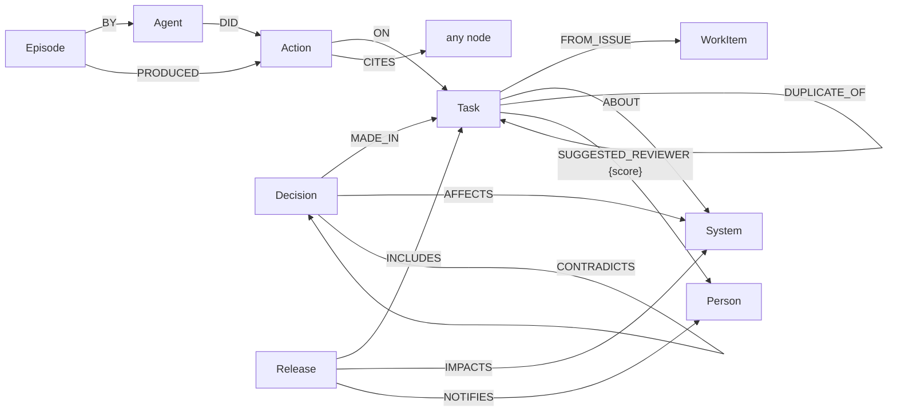

# Agents

Four agents carry the product: `brain` answers questions (Ask), `keeper` keeps the brain right,
and `pm` and `qa` advise the Keeper. Agents do not write code or touch GitHub. Each one reads the
company brain, makes one decision, and writes the result into a graph. The graph is the only
channel between agents: there are no agent-to-agent messages. A handoff is a record that shows up
in the next agent's queue query.

The Keeper comes first below ([The Keeper](#the-keeper)). The rest of this file is the original
spec of a **simulated software company** (sprints, developers, DevOps, releases). Its phase 1 is
built and its code stays, but the simulation is **no longer the product story**: agents act on
what the Keeper writes, not on simulated sprints. `builder` and `critic` stay in code and leave
the demo (the Keeper is the single writer of knowledge and its checks replace the Critic's).
There is no designer agent.

## The Keeper

Code: `apps/agents/agents/keeper/` (records, ledger store, gaps, noticing, rules, decide,
projection, review run), `agents/roles/keeper.py` (the decide job, and the consult job pm and qa
share), `apps/brain/brain/keeper.py` (its reads and writes on `brain_<slug>`),
`apps/backend/backend/keeper_runs.py` and `api/keeper.py`.

### Agents and jobs

| Role | DB user | Jobs | Writes |
|---|---|---|---|
| `brain` | `citadel_brain` | Ask. Reads `keeper_notes` and `Claim` neighbours of `get_entity`, only for what the sources don't say, and says so | a gap for each failed turn or thumbs-down |
| `keeper` | `citadel_keeper` | `decide`: reads a gap in review and both consult answers, submits `submit_keeper_decision`: a claim, `needs_person` or `dismiss` | claims (through the fixed checks below), the log, projected `Claim` nodes |
| `pm` | `citadel_pm` | `consult`: answers its consults (`submit_consult`); `follow_up`: one task per claim that needs one (`submit_follow_up`) | consult answers, follow-ups |
| `qa` | `citadel_qa` | `consult`: answers its consults (regression risk, test evidence) | consult answers |

A consult answer is a draft claim (kind, subject, statement, value) citing uids the role saw in
this run's tool results, or `can_ground: false`. Every job has a deterministic offline policy
(`agents/policies/keeper.py`, `pm.py`, `qa.py`), so `make test` and `--offline` runs call no API.

### The ledger (`keeper_<slug>`)

The Keeper's source of truth, in its own graph so a rebuild of `brain_<slug>` cannot remove it:
gaps, consults (one per role per attempt at a gap), claims of every status, follow-ups, the
append-only log and the review runs. Records point at brain nodes by uid string. Labels and
properties: [graph-model.md](graph-model.md#the-keepers-ledger-keeper_slug). Agents reach it
through the `WorkStore` protocol (`agents/keeper/store.py`: `KeeperStore` on FalkorDB,
`MemoryKeeperStore` for tests), every read and write a named query in `queries/ledger/`.

### Gaps

- **Failed question.** An Ask turn with no answer or no cited source opens a `failed_question`
  gap; a thumbs-down opens a `thumbs_down` gap. Both are written after the answer or rating is
  sent (a background task in the API), best effort: a gap write never fails an answer. The same
  normalised question bumps the live gap's `count` instead of adding one. A zero-source answer
  that is later thumbed down makes two gaps, one of each kind.
- **Noticing.** After a build (and at the start of every review), fixed queries open gaps:
  `stale_owner` (a system's declared owners do not include the person doing most of its
  work) and `unowned_hot_system` (recent changes, no declared owner). At most `KEEPER_NOTICE_CAP` (10) new
  gaps per run. A subject is skipped when it has an accepted owner claim or a follow-up fixing
  its source, or when its latest gap of that kind was resolved, dismissed or marked needs a
  person, so a dismissed or `needs_person` subject is not raised again.

### Sources win

A claim never overrides the sources. An `owner` claim whose value is not among the declared
owners, or an `expert` claim that is not the top of `experts_for_system`, is stored as
`conflicts_with_source` with both sides in the log. It is never projected, skips approval, and
`pm` opens a follow-up to fix the source (for example, update CODEOWNERS). When a later ingest
brings the fixed source, the brain is right on its own. After every build each accepted claim is
checked again; one the sources now contradict is `superseded`, logged with the source as the
reason.

### The critical rule

Fixed in code (`agents/keeper/rules.py`), not the model's opinion. A claim needs a lead's approval
when any of these hold; the reasons are stored in `critical_reasons`:

- `replaces_claim`: an accepted claim with the same kind and subject exists (for a decision: any
  accepted decision about the same system);
- `high_impact_system`: one of its `about` systems is in the top quarter by co-change coupling;
- `no_source_evidence`: none of its evidence is a `Change`, `WorkItem` or `Document`.

### Deciding a gap (`agents/keeper/decide.py`)

1. `dismiss` or `needs_person`: the gap leaves review.
2. Every evidence uid must exist in `brain_<slug>`, else the claim is `rejected` and the gap goes
   back to `open` with one more attempt; after 2 attempts it is `needs_person`.
3. Sources win (above).
4. Critical: `pending_approval`, the gap stays in review until a lead acts. Not critical:
   `accepted` at once (approver `auto`), projected into the brain, the gap resolved, and the
   earlier accepted claim of the same kind and subject `superseded` (`valid_to` set).

A lead approves or rejects with `agents keeper approve|reject SLUG CLAIM --by NAME` or the API.
Approval re-checks the sources first. Each status move is guarded on the current status, so of
two racing approvals one wins and the other is told the claim was decided (HTTP 409). A rejected
claim sends its gap back to `open` with one more attempt. Nothing is deleted.

### The review run (`agents/keeper/review.py`)

One bounded pass, at most one per company at a time (a second start returns the running one):

1. Release gaps an earlier review left in review with no claim waiting for a lead.
2. Re-project every accepted claim (superseded by the sources, stale when its subject or every
   evidence uid is gone, else written back into the brain), then notice.
3. Pick the budget's gaps (asked gaps first, then most seen, then oldest): `KEEPER_BUDGET` (5) on
   Review now or `agents keeper review`, `KEEPER_BUILD_BUDGET` (3) after a build, 0 after an
   approval (so pm's follow-up shows).
4. Post a pm and a qa consult per gap, run their consult jobs, then the Keeper's decide job.
5. Run pm's follow-up job for each claim that needs one: an accepted owner, expert or decision
   claim, or a `conflicts_with_source` claim.

It stops between jobs when asked, and stops safely (`brain_unavailable`) when `brain_<slug>` is
gone, writing nothing an empty brain would make wrong. Gaps it picked and did not decide go back to
`open` without using an attempt. Without an API key a review only re-projects and notices, and is
recorded `skipped`; `--offline` runs the scripted policies instead. A server restart marks a
running review `stopped`. Every step is a `LogEntry` and a progress event.

### Surfaces

- **CLI:** `agents keeper notice|review|gaps|claims|log|approve|reject SLUG`; `make keeper-notice`,
  `keeper-review` (`OFFLINE=1`, `BUDGET=n`), `keeper-gaps` (`STATUS=`), `keeper-log` (`LIMIT=`).
- **API** under `/api/companies/{slug}/keeper/`: `GET gaps`, `GET claims`, `GET log`,
  `GET followups`, `POST claims/{uid}/approve` and `/reject` (body: `by`, `why`; 409 when the
  claim was already decided), `POST review` (Review now; returns the running review if there is
  one), `POST review/stop`, `GET review/events` (SSE). The backend starts a review after every
  finished build.
- **App:** planned. Keeper reviews appear as steps on the Systems page's agent trail, with Review
  now, the approvals card and the log in its rail; the UI lands with the Systems page.
- **Reset:** `make reset SLUG=x CONFIRM=1` deletes `keeper_x` with the company's other graphs.

---

# The simulated company (original spec)

No longer the product story; kept as the spec of the phase 1 code. Sections below describe the
simulation's design, much of it not built (see [Implementation status](#implementation-status)).

## Ground rules

1. **The graph is the only channel.** Agents read their queue from FalkorDB and write their
   result to FalkorDB. Nothing is passed in memory between agents.
2. **No LLM-written Cypher.** Reads go through named tools (`queries/tools/*.cypher`), writes go
   through named write queries (`queries/work/*.cypher`). The LLM only chooses tools and fills
   their parameters.
3. **Every action is grounded.** Each `Action` must cite uids that appeared in tool results in
   that run (the same rule `submit_answer` already enforces).
4. **One legal move per write.** Each write query checks the current state in its `WHERE`
   clause, so an agent can only make its own transition (QA cannot release a task, a developer
   cannot pass its own QA). A write that matches nothing means "someone else got there first"
   or "not allowed".
5. **Every agent is its own FalkorDB user** with ACL rules (see Permissions). Read-only agents
   cannot write even if a prompt tells them to.
6. **Every role has an offline policy.** A deterministic Python policy can stand in for the LLM,
   so simulations and tests run with no API key (same idea as `agents/offline.py`).

## Shared model

New labels and relationships in `brain_<slug>`, on top of the existing model in
[graph-model.md](graph-model.md).



| Label | Key properties |
|---|---|
| `Task` | `uid`, `title`, `body`, `status`, `priority`, `qa`, `pm`, `assignee`, `lease_until`, `acceptance` (list), `plan`, `planned_files` (list), `report`, `created_ts`, `updated_ts` |
| `Agent` | `uid` (`agent:dev-1`), `role`, `db_user`, `model` |
| `Action` | `uid`, `kind`, `summary`, `ts`, `agent`, `task` |
| `Episode` | `uid`, `agent`, `run_at`, `tick`, `input`, `summary`, `tools_called` (list) |
| `Decision` | `uid`, `summary`, `rationale`, `valid_from`, `valid_to`, `status` |
| `Release` | `uid`, `name`, `ts`, `notes` |

**Task status:** `open → triaged → in_progress → done → released`, plus `rejected`
(duplicate or out of scope) and `blocked`.

**Gates on a done task:** `qa: pending → testing → passed | failed` and
`pm: pending → reviewing → accepted | changes_requested`. Either gate failing sends the task
back to `in_progress` with the same assignee.

**Action kinds:** `seeded`, `triaged`, `rejected`, `claimed`, `planned`, `completed`,
`qa_started`, `qa_passed`, `qa_failed`, `pm_accepted`, `pm_changes_requested`, `released`,
`decision_recorded`, `decision_superseded`, `contradiction_found`, `lease_expired`.

### Constraints (`queries/schema/constraints.cypher`)

The database enforces these, whatever an LLM produces:

- `UNIQUE` on `uid` for `Task`, `Action`, `Agent`, `Episode`, `Decision`, `Release`
  (each needs its range index on `uid` first, which `range_indexes.cypher` already creates for
  existing labels; add the new labels there).
- `MANDATORY` on `Action(agent, kind, ts)`, `Task(title, status)`, `Decision(summary, valid_from)`.

### Derived edges (`queries/derive/*.cypher`, run by `brain derive <slug>` after ingest)

Graph algorithms run on relationships, so two weighted projections are materialised from the
raw activity:

- `(Person)-[:COLLABORATES {w}]->(Person)`: one reviewed the other's PR, or both commented on
  the same work item, weighted by count and recency.
- `(System)-[:CO_CHANGES {w}]->(System)`: changed in the same commit, weighted by count.

Algorithm scores are then written back as properties so queue queries can sort on them:
`System.pagerank`, `Person.betweenness`, `Person.community`, `Person.harmonic`.

```cypher
// derive/co_changes.cypher
MATCH (a:System)<-[:TOUCHES]-(c:Change)-[:TOUCHES]->(b:System)
WHERE id(a) < id(b)
WITH a, b, count(c) AS w
MERGE (a)-[r:CO_CHANGES]->(b)
SET r.w = w
```

```cypher
// derive/system_pagerank.cypher
CALL algo.pageRank('System', 'CO_CHANGES') YIELD node, score
SET node.pagerank = score
```

### UDFs (`queries/udfs/`, loaded by `make schema` with `GRAPH.UDF LOAD REPLACE`)

- **FLEX** (FalkorDB's community library): `flex.sim.jaccard` for file-set overlap between
  tasks, `flex.text.jaroWinkler` for login alias matching at ingest.
- **`citadel` library** (our JavaScript):
  - `citadel.decay(ts, now, half_life_days)`: one recency weight used by every query.
  - `citadel.priority(pagerank, mentions, age_days, severity)`: the one priority formula that
    every queue sorts by, so all agents agree on what is urgent.

## The agent contract

Every role implements the same small interface (`apps/agents/agents/roles/base.py`):

```python
class Role(Protocol):
    name: str                       # "qa"
    db_user: str                    # FalkorDB ACL user this role connects as
    read_tools: list[str]           # names from brain.tools.TOOLS
    write_tool: str                 # one submit_* tool, maps to one queries/work/*.cypher

    def queue(self, slug: str) -> list[TaskRef]: ...     # named query, ordered by priority
    def claim(self, slug: str, task: TaskRef) -> bool: ...  # atomic; False = someone else got it
    def act(self, slug: str, task: TaskRef) -> Action: ...  # LLM tool loop or offline policy
```

`act` reuses the existing brain loop (`agents/loop.py`) with a role prompt
(`apps/agents/agents/prompts/<role>.md`), the role's read tools, and exactly one submit tool. The
submit tool's pydantic model is the write query's parameter model, so the LLM cannot write
fields the query does not take. Every run writes one `Episode`.

### Atomic claim (the pattern every queue uses)

FalkorDB runs write queries on a graph one at a time, so check-and-set in one query is safe
under any number of competing agents:

```cypher
// work/claim_task.cypher
MATCH (t:Task {uid: $task})
WHERE t.status = 'triaged' AND (t.assignee IS NULL OR t.lease_until < $now)
SET t.status = 'in_progress', t.assignee = $agent, t.lease_until = $now + $lease_s,
    t.updated_ts = $now
RETURN t.uid
```

No row back means the claim failed. Gate claims (`qa`, `pm`) are the same shape on their own
field.

---

## Core agents

### 1. PM agent

**Goal:** turn raw issues into well-formed, prioritised tasks, and later accept or reject
finished work against the acceptance criteria it wrote.

- **Tier:** 1
- **DB user:** `citadel_pm`, read-write on `brain_<slug>` and `sim_<slug>_*`, read on
  `mem_<slug>_*` (to pick up other agents' findings), read-write on `mem_<slug>_pm`.

**Job A: Intake and triage**

- **Wakes on:**
  - open issues with no task yet (`work/untasked_issues.cypher`), which it seeds as tasks;
  - tasks in `open`;
  - findings in the Risk agent's memory graph that have no task yet.
- **Reads:**
  - `related_work_items` (duplicates and history)
  - `semantic_similar_tasks` (new, vector)
  - `list_systems`
  - `work_history`
  - `System.pagerank`
- **Decides:** duplicate or not; the target system; priority; 2–4 acceptance criteria.
- **Writes:** `submit_triage` → `work/triage_task.cypher`
  - `open → triaged` with `priority`, `acceptance` and `ABOUT → System`;
  - or `open → rejected` with `DUPLICATE_OF`.

**Job B: Acceptance**

- **Wakes on:** `status = 'done' AND pm = 'pending'`.
- **Reads:** the task's own acceptance criteria, the developer's report, and the task's
  `Action` trail.
- **Writes:** `submit_acceptance` → `pm: accepted`, or `changes_requested` with the reason
  (which sends the task back to `in_progress`).

**Tier 3 extra: staffing.** Uses `Person.community` (label propagation) to group tasks by the
real collaboration cluster, and `algo.maxFlow` to check that developer capacity can cover all
P0 tasks before the sprint starts.

- **FalkorDB shown:** vector + full-text hybrid search, PageRank, the `citadel.priority` UDF,
  `MERGE` dedupe, constraints.
- **Done when:** given ten seeded issues including two near-duplicates, it creates eight
  triaged tasks and two `rejected` ones with `DUPLICATE_OF`, each with `ABOUT` and acceptance
  criteria.

### 2. Developer agent (run two or more)

**Goal:** claim work, plan a concrete implementation grounded in how the codebase really
changes, and report completion.

- **Tier:** 1
- **DB user:** `citadel_dev`, read-write on `brain_<slug>`, `sim_<slug>_*` and
  `mem_<slug>_dev`. All developer instances share the user but have their own `Agent` node.
- **Wakes on:**
  - `status = 'triaged'` and unassigned or with an expired lease, ordered by
    `citadel.priority` (it claims one atomically);
  - its own tasks sent back by QA or the PM.
- **Reads:**
  - `work_history` (similar past PRs in the system)
  - `files_for_system` (new: the files past commits touched in that system)
  - `experts_for_system` (who to ask)
  - `impact_of` (what else tends to change with it)
  - `conflicting_tasks` (new)
  - its own lessons from `mem_<slug>_dev`
- **Decides:**
  - which files to change;
  - the risks;
  - who to consult;
  - whether to proceed or pick another task if another in-progress task overlaps too much.
- **Writes:**
  - `submit_plan` → `planned_files`, `plan`, Action `planned`;
  - then `submit_completion` → `in_progress → done`, `qa = pending`, `pm = pending`, `report`,
    Action `completed`.
  - When rework comes back, it must address the QA or PM reason in the new report.
- **Conflict check:**

  ```cypher
  // tools/conflicting_tasks.cypher
  MATCH (t:Task {uid: $task}), (o:Task {status: 'in_progress'})
  WHERE o <> t AND flex.sim.jaccard(t.planned_files, o.planned_files) > $threshold
  RETURN o.uid, o.assignee, flex.sim.jaccard(t.planned_files, o.planned_files) AS overlap
  ```

- **FalkorDB shown:** atomic conditional writes, leases, the FLEX `jaccard` UDF, co-change
  data.
- **Done when:** five developer instances racing for three triaged tasks produce exactly three
  `claimed` actions and three distinct assignees, every time.

### 3. QA agent

**Goal:** test each finished task against the company's real history of regressions in that
area, and fail it with a concrete reason when the plan misses one.

- **Tier:** 1. The vector part is Tier 2; Tier 1 uses full-text.
- **DB user:** `citadel_qa`, read-write on `brain_<slug>`, `sim_<slug>_*` and `mem_<slug>_qa`.
- **Wakes on:** `status = 'done' AND qa = 'pending'` (it claims by setting `qa = 'testing'`).
- **Reads:**
  - `past_regressions` (new): fix PRs and bug issues in the task's system, found by full-text
    plus vector similarity over comment chunks, expanded through `Chunk-FROM->WorkItem`;
  - `work_history`;
  - the developer's plan and report;
  - its own lessons.
- **Decides:**
  - a short test plan built from the past regressions it found;
  - pass, or fail citing the specific regression the plan does not cover.
- **Writes:** `submit_qa` → `qa: passed`, or `qa: failed` with the reason. A failure also sets
  `status = 'in_progress'`, the task goes back to the same developer, and the Action cites the
  regression's uid.
- **Procedural memory:** after the same failure reason appears for the same system twice, it
  writes a `Lesson` to `mem_<slug>_qa` ("Indexing changes must cover the index rebuild path,
  see #123"). Lessons are read at the start of every QA run, and also by developers (the dev
  user has read access to `mem_<slug>_qa`).
- **FalkorDB shown:** HNSW vector index, full-text index, hybrid retrieval with graph
  expansion, per-agent memory graph.
- **Done when:** a seeded task whose plan omits a known regression fails, is reworked, then
  passes, and a lesson exists after the second occurrence.

### 4. DevOps / Release agent

**Goal:** ship accepted work in safe, independent batches, and tell the right people what
the release touches.

- **Tier:** 1
- **DB user:** `citadel_devops`, read-write on `brain_<slug>`, `sim_<slug>_*` and
  `mem_<slug>_devops`.
- **Wakes on:** `status = 'done' AND qa = 'passed' AND pm = 'accepted'`. It marks these with
  the label `:ReleaseCandidate`.
- **Reads:**
  - `release_trains` (new, WCC): splits candidates into groups that share no systems, so each
    group can ship on its own;
  - `blast_radius` (new, `SSpaths` over `CO_CHANGES` from each affected system, bounded by
    `maxLen`);
  - `experts_for_system` and declared owners (who to notify).
- **Decides:** release names, the release notes, and whether a train is too risky to ship
  this tick (for example a very large blast radius, which it holds for one tick).
- **Writes:** `submit_release` → a `Release` node with `INCLUDES` tasks, `IMPACTS` systems
  (with depth) and `NOTIFIES` people. Tasks become `released` and the `:ReleaseCandidate`
  label is removed.

  ```cypher
  // tools/release_trains.cypher
  CALL algo.WCC({nodeLabels: ['ReleaseCandidate', 'System'], relationshipTypes: ['ABOUT']})
  YIELD node, componentId
  WITH componentId, collect(node) AS members
  WITH componentId, [m IN members WHERE m:ReleaseCandidate] AS tasks
  WHERE size(tasks) > 0
  RETURN componentId, [t IN tasks | t.uid] AS task_uids
  ```

  ```cypher
  // tools/blast_radius.cypher
  MATCH (s:System {uid: $system})
  CALL algo.SSpaths({sourceNode: s, relTypes: ['CO_CHANGES'], relDirection: 'both',
                     maxLen: $depth, pathCount: 100})
  YIELD path, pathCost
  RETURN [n IN nodes(path) | n.uid] AS chain, length(path) AS depth
  ```

- **FalkorDB shown:** WCC, `SSpaths`, labels used as dynamic queues.
- **Done when:** six accepted tasks across two unrelated systems groups produce two releases,
  each with its impact list and notified owners.

### 5. Builder agent (company memory)

**Goal:** turn finished work into durable `Decision` nodes, so later agents and humans can ask
why something is the way it is.

- **Tier:** 2
- **DB user:** `citadel_builder`, read-write on `brain_<slug>` and `sim_<slug>_*`.
- **Wakes on:** `released` tasks with no `Decision` (`MADE_IN`), and merged PRs in the window
  that have a long review discussion.
- **Reads:** the task's `Action` trail, the plan and report, the linked PRs and comment
  chunks.
- **Decides:** zero to two decisions per task, each a one-line summary and rationale.
  "Nothing worth recording" is allowed.
- **Writes:** `submit_decisions` → `Decision {valid_from: now}` with `MADE_IN → Task|WorkItem`
  and `AFFECTS → System`.
- **FalkorDB shown:** semantic memory as first-class nodes linked to their sources.
- **Done when:** each released task in the sprint simulation has a decision or an explicit
  "none" episode, and every decision traces to a PR or task.

### 6. Critic agent

**Goal:** keep company memory consistent: notice when a new decision replaces or contradicts
an old one, and make the conflict visible instead of letting it silently drift.

- **Tier:** 2
- **DB user:** `citadel_critic`, read-write on `brain_<slug>` and `sim_<slug>_*`.
- **Wakes on:** decisions with no `checked_by_critic`.
- **Reads:**
  - `decisions_for_system` (new): current decisions on the same systems;
  - `decisions_as_of` (new): time-travel view.
- **Decides:** for each pair, one of supersedes, contradicts, or unrelated.
- **Writes:**
  - **supersedes:** a `SUPERSEDES` edge, and the old decision's `valid_to` is set to now;
  - **contradicts:** a `CONTRADICTS` edge, plus a new `open` task for the PM ("Resolve:
    decision X conflicts with Y"). Memory creates new work, which closes the loop.

  ```cypher
  // tools/decisions_as_of.cypher
  MATCH (d:Decision)-[:AFFECTS]->(s:System {uid: $system})
  WHERE d.valid_from <= $ts AND (d.valid_to IS NULL OR d.valid_to > $ts)
  RETURN d.uid, d.summary, d.valid_from, d.valid_to
  ```

- **FalkorDB shown:** time-bounded facts, time-travel queries, self-generated work.
- **Done when:** in the time-travel simulation, "as of" before and after the change returns
  different current decisions, and the contradiction produces a PM task.

### 7. Risk watchdog (read-only)

**Goal:** spot organisational risk in the graph before it becomes an incident: people the
company can't lose, systems only one person understands, owners who no longer do the work.

- **Tier:** 1. It's needed for the "key person leaves" and "rogue agent" simulations.
- **DB user:** `citadel_risk`, **read-only** on `brain_<slug>` and `sim_<slug>_*`, read-write
  only on `mem_<slug>_risk`. It cannot change the brain under any prompt.
- **Wakes on:** every N ticks, and right after a what-if mutation.
- **Reads:**
  - `bottleneck_people` (new, betweenness over `COLLABORATES`);
  - `single_expert_systems` (new: the top expert holds more than 70% of the recency-weighted
    activity);
  - `owners_vs_experts`;
  - `best_first_contact` (new, harmonic centrality).
- **Writes:** `Finding` nodes in its own graph `mem_<slug>_risk` only. The PM's intake job
  reads those findings and decides whether to open tasks. A finding stores the uids it cites
  as strings, because relationships can't cross graphs.
- **FalkorDB shown:** betweenness and harmonic centrality, per-graph ACL, cross-graph handoff
  through permissions rather than shared writes.
- **Done when:** in the key-person simulation, the fork lists the systems orphaned by the
  departure and the baseline does not. A write attempted as `citadel_risk` on `brain_<slug>`
  is refused by FalkorDB.

### 8. Brain agent (exists: human Q&A)

**Goal:** answer people's questions with citations and graph paths. This is the current
`agents ask` / `agents chat`.

- **Tier:** done. Extend in Tier 2 with the new read tools.
- **DB user:** `citadel_brain`, read-only on `brain_<slug>`, read-write on `agent_<slug>`
  (checkpoints).
- **Changes (not built):** add tools that read the work layer:
  - `task_timeline` (the full `Action` trail of a task);
  - `decisions_for_system` and `decisions_as_of`;
  - `release_contents`.
  Questions like "why was #412 sent back?", "what did we believe about Auth on Oct 10?" and
  "who was told about release 3?" then all work. Today Ask gets only the graph tools from
  `brain.tools` (`agents/toolset.py`, `graph_toolset`) plus the company's MCP servers; the
  work-layer tools go only to the role jobs.

---

## Optional agents (Tier 3)

### 9. Reviewer-matcher

- **Goal:** suggest human reviewers for each task, with the path that justifies them.
- **DB user:** `citadel_reviewer`, read-write on `brain_<slug>`.
- **Wakes on:** tasks entering `done`.
- **Reads:** `experts_for_system`, `path_between` (`SPpaths` from the candidate to the task's
  system), and `Person.community` for spreading review load.
- **Writes:** `SUGGESTED_REVIEWER {score, path}` edges to up to two people.
- **Replay score:** seed tasks from older real issues whose fix PR is known, and report how
  often the suggested reviewer actually reviewed that PR. This is the strongest Track 01
  evidence.

### 10. Staffing

Folded into the PM agent as described above (label propagation communities and the MaxFlow
capacity check). Make it its own role only if the PM prompt gets too large.

**Not building:** a UI designer agent. The FalkorDB repo has no UI work to ground it, so it
would be the one agent that is pure role-play.

---

## Orchestrator (`apps/agents/agents/sim/orchestrator.py`, not an LLM)

- **Tick loop:**
  1. Expire leases (a `lease_expired` Action is logged).
  2. Run each role in a fixed order (`STEPS`): PM triage → developers → QA → PM acceptance →
     DevOps → Builder → Critic → Risk (every N ticks) → Reviewer.
  3. Each role handles at most one task per tick.
  4. Emit the tick's actions as events for the UI.
- **Concurrency mode:** for the race simulation, run all developer instances in parallel
  threads within one tick.
- **Forks:** `fork(slug, run)` runs `GRAPH.COPY brain_<slug> sim_<slug>_<run>`, and every role
  in that run connects to the fork. The run-scoped name comes from `agents.graphs`; `db.py`
  still opens the connection.
- **Stops when:** no queue has work, a tick limit is hit, or the run is paused. It can step one
  tick at a time from the UI.
- **CLI:**

  ```bash
  agents sim run <slug> --scenario sprint --ticks 30 [--offline]
  agents sim step <run_id>
  agents sim fork <slug> --run what-if-1
  make sim SLUG=synthetic SCENARIO=race OFFLINE=1
  ```

## Permissions (one FalkorDB user per role)

| User | `brain_<slug>` | `sim_<slug>_*` | `mem_<slug>_*` | `agent_<slug>` | `keeper_<slug>` |
|---|---|---|---|---|---|
| `citadel_loader` | RW | | | | |
| `citadel_orchestrator` | RW | RW (creates forks) | | | |
| `citadel_keeper` | RW (projects claims) | | | | RW |
| `citadel_pm` | RW | RW | R all, RW own | | RW |
| `citadel_dev` | RW | RW | RW own, R `qa` | | |
| `citadel_qa` | RW | RW | RW own | | RW |
| `citadel_devops` | RW | RW | RW own | | |
| `citadel_builder` | RW | RW | | | |
| `citadel_critic` | RW | RW | | | |
| `citadel_risk` | **R** | **R** | RW own | | |
| `citadel_brain` | **R** | **R** | | RW | RW (opens gaps) |
| `citadel_reviewer` | RW | RW | | | |

The table lives in `agents/acl.py` (`PERMISSIONS`). `acl.setuser_commands(slug, passwords)`
renders it as `ACL SETUSER` lines; no CLI command runs them yet (phase 2). For example:

```text
ACL SETUSER citadel_risk on >${PW} +@all %R~brain_falkordb %R~sim_falkordb_* %RW~mem_falkordb_risk
```

Graph-level permissions are a newer FalkorDB feature: test them against the `falkordb:latest`
image first. Writer agents are additionally held to their own transitions by the guarded
write queries (ground rule 4), which is the second layer of defence in the rogue-agent
simulation.

## New query files

| Folder | Files |
|---|---|
| `schema/` | `constraints.cypher` |
| `derive/` | `collaborates.cypher`, `co_changes.cypher`, `system_pagerank.cypher`, `person_betweenness.cypher`, `person_communities.cypher`, `person_harmonic.cypher` |
| `work/` | `untasked_issues.cypher`, `seed_task.cypher`, `triage_task.cypher`, `reject_task.cypher`, `claim_task.cypher`, `plan_task.cypher`, `complete_task.cypher`, `claim_gate.cypher`, `qa_result.cypher`, `pm_result.cypher`, `mark_release_candidates.cypher`, `create_release.cypher`, `record_decisions.cypher`, `supersede_decision.cypher`, `contradiction.cypher`, `write_action.cypher`, `write_episode.cypher`, `expire_leases.cypher`, and one queue query per role (`queue_<role>.cypher`) |
| `tools/` | `semantic_similar_tasks`, `files_for_system`, `conflicting_tasks`, `past_regressions`, `release_trains`, `blast_radius`, `decisions_for_system`, `decisions_as_of`, `bottleneck_people`, `single_expert_systems`, `best_first_contact`, `task_timeline`, `release_contents`, `community_of` |
| `udfs/` | `citadel.js` (`decay`, `priority`); FLEX loaded from its release |

Existing tools that respect people leaving (`experts_for_system`, `person_profile`) need
`WHERE coalesce(p.active, true)` so what-if forks change their answers.

## Code layout

```
apps/agents/agents/
  keeper/        the Keeper: model, store (ledger), gaps, notice, rules, decide, project, review
  roles/         base.py, keeper.py, pm.py, developer.py, qa.py, devops.py, builder.py,
                 critic.py, risk.py, reviewer.py, brain.py
  prompts/       _shared.md, keeper.md, pm.md, developer.md, qa.md, devops.md, builder.md,
                 critic.md, risk.md, reviewer.md
  policies/      offline deterministic policy per role (tests and --offline)
  work/          records, legal task moves, submit models, WorkStore
  sim/           orchestrator.py, scenarios.py
  graphs.py      names of the agent_<slug>, keeper_<slug>, mem_<slug>_<role> and sim_<slug> graphs
  acl.py         the permission table, checks, and ACL SETUSER lines for FalkorDB users
```

`agents/graph.py` runs human chat: every turn goes straight to the brain loop. The Builder and
Critic jobs are the roles above, not nodes in that graph.

## Simulations (one button each in the UI)

| # | Scenario | Agents | FalkorDB features it proves |
|---|---|---|---|
| 1 | **Sprint**: ten real issues go from open to released | all core | Queues, constraints, PageRank, WCC, `SSpaths`, decisions |
| 2 | **The race**: five developers compete for three tasks | Developer ×5 | Atomic writes, `UNIQUE` constraints |
| 3 | **Regression loop**: QA fails, the developer reworks, a lesson is learned | Developer, QA | Vector and full-text hybrid search, per-agent memory |
| 4 | **Key person leaves**: fork the brain, remove the top expert, compare | Risk, PM | `GRAPH.COPY`, betweenness, expertise queries |
| 5 | **Strategy A vs B**: two forks, PageRank priority vs age priority | all core | `GRAPH.COPY`, multigraph |
| 6 | **Rogue agent**: a prompt injection in an issue body | Risk, Brain, QA | ACL graph permissions, `RO_QUERY`, guarded writes |
| 7 | **Time travel**: a new decision replaces an old one, then "as of" queries | Builder, Critic, Brain | Time-bounded facts |
| 8 | **Two companies at once**: same agents on `brain_synthetic` and `brain_falkordb` | all core | Multigraph tenant isolation |

Each action card in the UI shows the feature badge, the named query that ran, and its
`GRAPH.PROFILE` output.

## Build order

| Tier | When | Scope |
|---|---|---|
| 1 | Fri night → Sat midday | Constraints, Task/Agent/Action/Episode writes, claim and leases, orchestrator, PM, Developer, QA (full-text), DevOps, Risk, derive step with PageRank, betweenness and CO_CHANGES, ACL users. Simulations 1, 2 and 6. |
| 2 | Sat | Embedding job and vector search in QA and PM, Builder, Critic, time travel, `GRAPH.COPY` forks, `citadel` UDF and FLEX conflict check, Brain's new tools, PROFILE capture. Simulations 3, 4 and 7. |
| 3 | Sun, only if ahead | Reviewer-matcher with replay score, label propagation staffing, MaxFlow, harmonic first contact, FalkorDB MCP server for an outside agent. Simulations 5 and 8. |

Every role needs a test with its offline policy and a throwaway graph (the same setup as
`apps/brain/tests/test_graph.py`). A simulation passes when its "done when" checks above hold.

## Implementation status

**The Keeper** is built (see [The Keeper](#the-keeper)): its ledger store on FalkorDB, gaps from
Ask, noticing, the review run with pm and qa consults, the decide step with the sources-win and
critical rules, approvals, projection, `keeper_notes`, the CLI, the backend runs and the API. Its
app UI lands with the Systems page.

The simulation was built in two phases. **Phase 1 (agents)** is done; **phase 2 (connect to the
brain)** is not being built now that the simulation is no longer the product story.

**Phase 1: the agents and their contract** (`agents/work`, `agents/roles`,
`agents/policies`, `agents/prompts`, `agents/sim`, all under `apps/agents/`):

- `work/model.py`: Task, Action, Episode, Decision, Release, Finding, Lesson records and the
  status, gate and action-kind enums.
- `work/moves.py`: every legal task move (who may make it, what state it requires, what it
  sets) in one table. The in-memory store enforces it, and phase 2's `queries/work/*.cypher`
  guards must match it.
- `work/submits.py`: one pydantic model per `submit_*` tool. These are the parameter models
  of the phase 2 write queries.
- `work/store.py`: the `WorkStore` protocol: `read(name, params)` and
  `write(name, db_user, params)` on named queries, exactly like `db.run`.
  `work/memory_store.py` is the offline/test double that implements every named read and
  write in Python, with the same guards and the ACL table from `acl.py`. It is not a second
  channel: phase 2 replaces it with the FalkorDB store.
- `agents/roles/`: the nine roles (PM, developer, QA, DevOps, builder, critic, risk, brain,
  reviewer), each with jobs, a prompt, its read tools and one submit tool per job.
- `agents/runner.py`: runs one job on one subject through the brain loop (`loop.py`, now
  parameterised by prompt, submit tool and check), records the Action and the Episode.
- `agents/policies/`: a deterministic policy per job and a scripted client that plays a policy
  through the real loop, so offline runs exercise the same grounding checks as Claude.
- `sim/orchestrator.py` and `sim/scenarios.py`: the tick loop over the store, with the sprint,
  race and regression scenarios. `agents agents` lists the roles; `agents sim run <slug>
  --scenario sprint [--offline]` runs one against brain_<slug> (`make agents`, `make sim`).
  Agents read the brain through the real graph tools; offline, every role plays its policy.

**Phase 2: connect to the brain** (not built): the `queries/work/*.cypher` writes and
queues, `constraints.cypher`, the `derive/` step, the new `tools/` queries (role read tools
that are declared but not available yet are listed by `agents agents`), the `citadel` UDFs and
FLEX, ACL users created in FalkorDB, `GRAPH.COPY` forks, the FalkorDB store (so `agents sim`
writes the work layer into the graph), the `agents sim step` / `agents sim fork` commands, and
simulations 4 to 8.
