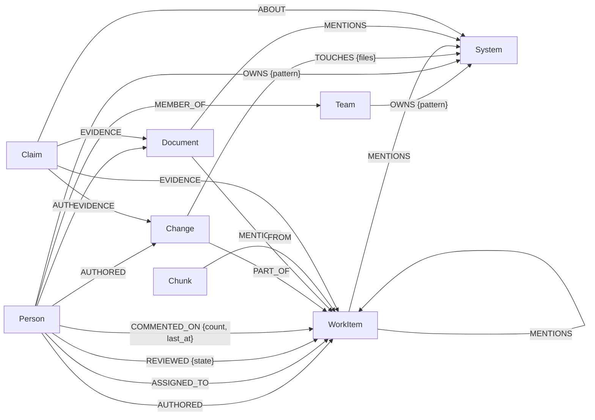

# Graph model

Each company is its own FalkorDB graph, `brain_<slug>`. Two more graphs per company live apart
from it: `agent_<slug>` (chat checkpoints and history) and `keeper_<slug>` (the Keeper's ledger,
[below](#the-keepers-ledger-keeper_slug)). Nothing is shared between company graphs, so one
company's query can never see another's data. FalkorDB is the only store: the product reads
nothing else at runtime.

`Claim` edges are drawn to their usual targets; `ABOUT` and `EVIDENCE` may point at any node
(a claim can be about a person, and cite a person or a system).

## Nodes

Every node has `uid` (stable; re-ingesting the same thing updates it in place), `company`,
`source` (`github`, `canonical_jsonl`, `local_docs`, `derived` ...) and, where one exists, `url`
(the citation a human can open). Timestamps are ISO strings (`created_at`, `date`) plus epoch
seconds (`created_ts`, `ts`) for recency maths, because FalkorDB temporal values have no epoch
accessor.

| Label | Key properties | Comes from |
|---|---|---|
| `Person` | `login`, `display_name`, `is_bot` | authors, reviewers, commenters, CODEOWNERS; uid `person:<login>` (lower-case) |
| `Team` | `name` | CODEOWNERS `@org/team`, JSONL; uid `team:<name>` |
| `System` | `name`, `path_rule` | file paths mapped by the company's `systems.rules`; uid `system:<name>` |
| `Change` | `sha`, `date`, `ts`, `kind` (feat/fix/perf/ci/build/docs/refactor/other), `subject` | commits |
| `WorkItem` | `kind` (pull_request/issue/ticket/thread), `number`, `title`, `body`, `state`, `created_at`, `closed_at`, `merged_at`, `labels`, `container`; tickets also `key`, `status_category` (backlog/todo/in_progress/done/canceled), `priority` (urgent/high/medium/low), `priority_rank` (1-4, 5 = none; null for PRs and issues), `due_date`, `due_ts` | PRs, issues, tickets, chat threads |
| `Document` | `path`, `title`, `body`, `updated_at` | repo markdown, published docs folders |
| `Chunk` | `kind`, `text`, `author_uid`, `ts`, `embedding` (vector, filled later) | comment text today; document/PR chunks for semantic search later |
| `Claim` | `kind` (owner/expert/decision/fact/link), `subject` (the uid it is about), `statement` (also `title`), `value` (e.g. the owner's uid), `status`, `valid_from`, `valid_to`, `author`, `approved_by` (a lead's typed name, or `auto`) | an accepted Keeper claim, projected from the ledger (`queries/keeper/project_claim.cypher`). Ingest never writes it |
| `SyncState` | `adapter`, `key`, `cursor`, `window_since`, `last_run`, `records` | ingestion bookkeeping, one per configured source |

People and systems get source-free uids, so the same login seen in GitHub and in a Slack export
is one node. No email addresses are stored anywhere: people are identified by login, and
normalize scrubs addresses out of every text field.

## Relationships

| Relationship | Meaning |
|---|---|
| `(Person)-[:AUTHORED]->(Change \| WorkItem \| Document)` | wrote it |
| `(Person)-[:REVIEWED {state, submitted_at, ts}]->(WorkItem)` | latest review per person and PR |
| `(Person)-[:COMMENTED_ON {count, last_at}]->(WorkItem)` | count recomputed from comment chunks, so it stays right on incremental ingests |
| `(Person)-[:MEMBER_OF]->(Team)` | team membership (when the source exposes it) |
| `(Team \| Person)-[:OWNS {pattern}]->(System)` | declared ownership (CODEOWNERS), patterns matched against the real file tree |
| `(Person)-[:ASSIGNED_TO]->(WorkItem)` | current assignees of a ticket. Replaced on every load: the item's old edges are deleted, then one is written per assignee, so reassigning moves it and an empty list unassigns. A source that does not track assignees (`None`) leaves the edges alone. `source` is the item's source |
| `(WorkItem)-[:BLOCKS {source, origin, uid}]->(WorkItem)` | ticket dependency. `origin` is the adapter key; after a load, edges with that origin whose `uid` the load did not write are deleted, so a removed dependency disappears. Other origins are never touched |
| `(Change)-[:TOUCHES {files}]->(System)` | which code areas a commit changed, and the files in each |
| `(Change)-[:PART_OF]->(WorkItem)` | commit belongs to a PR (PR commit list, merge commit, or `(#123)` in the subject) |
| `(WorkItem)-[:CLOSES]->(WorkItem)` | PR closes issue |
| `(WorkItem \| Document)-[:MENTIONS]->(WorkItem \| System)` | `#123` / PR URLs, and repo paths such as `src/index/`. A ticket can name a work item by its `url` (for example a GitHub PR): the loader matches it to the work item with that `url` |
| `(Chunk)-[:FROM]->(WorkItem)` | where a piece of text came from |
| `(Claim)-[:ABOUT]->(any)` | what a Keeper claim is about: its subject (and, for a decision, the systems it concerns). The Graph page does not draw claims yet |
| `(Claim)-[:EVIDENCE]->(any)` | the brain nodes the claim rests on; only uids that exist are linked |

## Expertise is derived, not stored

"Who knows this system?" is computed at query time from
`(Person)-[:AUTHORED]->(Change)-[:TOUCHES]->(System)` plus reviews of PRs whose commits touch the
system, each event weighted by recency (`experts_for_system`). No "expert" edge is ever written,
so the answer is current as soon as new commits are ingested, and the evidence (the commits and
PRs) is always one hop away for citation.

## Indexes (`queries/schema/`)

- Range indexes on every label's `uid`, plus `Person.login`, `WorkItem.number`, `WorkItem.key`, `WorkItem.url`, `System.name`.
- Full-text (RediSearch) on `WorkItem(title, body)` and `Document(title, body)`.
- Vector (HNSW, cosine) on `Chunk.embedding`, dimension `EMBEDDING_DIM`.

`make schema SLUG=<slug>` applies them; re-running is safe.

## Ingest window

A company config's `window.since` bounds the graph. Commits before it are not loaded. A PR,
issue or thread is loaded when it was created, closed or merged in the window, or got a comment
or review in it. A bare `updated_at` bump (a bulk relabel or a bot sweep) does not count.
An open ticket (its `status_category` is not `done` or `canceled`) is always loaded, whatever its
dates, so the graph keeps the current backlog.

## Keeper claims in the brain

The Keeper's knowledge is written beside the ingested facts, never over them: a re-ingest would
overwrite any edit to a loader-owned node, and the sources stay the record of what happened
("sources win").

- **Projection.** Every accepted claim is `MERGE`d on uid with its `ABOUT` and `EVIDENCE` edges
  (`keeper/project_claim`), after every accept and after every build, so a rebuild (which deletes
  `brain_<slug>`) gets them back. A claim whose subject or every evidence uid is gone is not
  projected: it goes `stale` in the ledger and its gap reopens.
- **Retiring.** A claim that is superseded, goes stale or is rejected later keeps its node with
  the new `status` and a `valid_to` (`keeper/retire_claim`); nothing is deleted. `keeper_notes`
  and `get_entity` show only current claims (`status = 'accepted'`, no `valid_to`).
- **Reading.** Ask uses claims only for what the sources don't say, cites their uids and says that
  part comes from the Keeper.

## The Keeper's ledger (`keeper_<slug>`)

The Keeper's source of truth. It survives a rebuild of `brain_<slug>`; `make reset` deletes it
with the company's other graphs. All reads and writes are the named queries in
`queries/ledger/`. Records point at brain nodes by uid string (graphs cannot link to each
other), so the ledger has no relationships. Timestamps are ISO-8601 UTC strings.

| Label | Key properties |
|---|---|
| `Gap` | `kind` (failed_question/thumbs_down/stale_owner/unowned_hot_system), `text`, `norm` (normalised question, the dedupe key), `subject` (a noticing gap's dedupe key), `status` (open/in_review/resolved/needs_person/dismissed), `count`, `attempts`, `trace_ids`, `about` |
| `Consult` | `gap`, `role` (pm/qa), `attempt`, `status` (open/answered), `can_ground`, the draft claim (`kind`, `subject`, `statement`, `value`), `cites`; uid `consult:<gap>:<role>:<attempt>` |
| `Claim` | as in the brain, plus `about`, `evidence`, `critical`, `critical_reasons` (replaces_claim/high_impact_system/no_source_evidence), `conflict` (the source fact it contradicts), `why`, `gap`; `status` pending_approval/accepted/rejected/superseded/stale/conflicts_with_source |
| `FollowUp` | `claim`, `title`, `body`, `by` (`pm`), `status` (open/done); one per claim, uid `followup:<claim>` |
| `LogEntry` | `at`, `actor` (keeper, pm, qa, a lead's name, or auto), `action` (gap_opened, consulted, claim_written, claim_queued, claim_approved, claim_rejected, claim_superseded, claim_stale, needs_person, follow_up_opened, review_done, ...), `why`, `gap`, `claim`, `evidence`; append-only |
| `Review` | `trigger` (build/manual/approval), `state` (running/done/stopped/failed/skipped), `budget`, `started_at`, `ended_at`, `stop`; at most one `running` per company |

Indexes: `queries/ledger/schema.cypher`, applied by the ledger store the first time it opens a
company.
